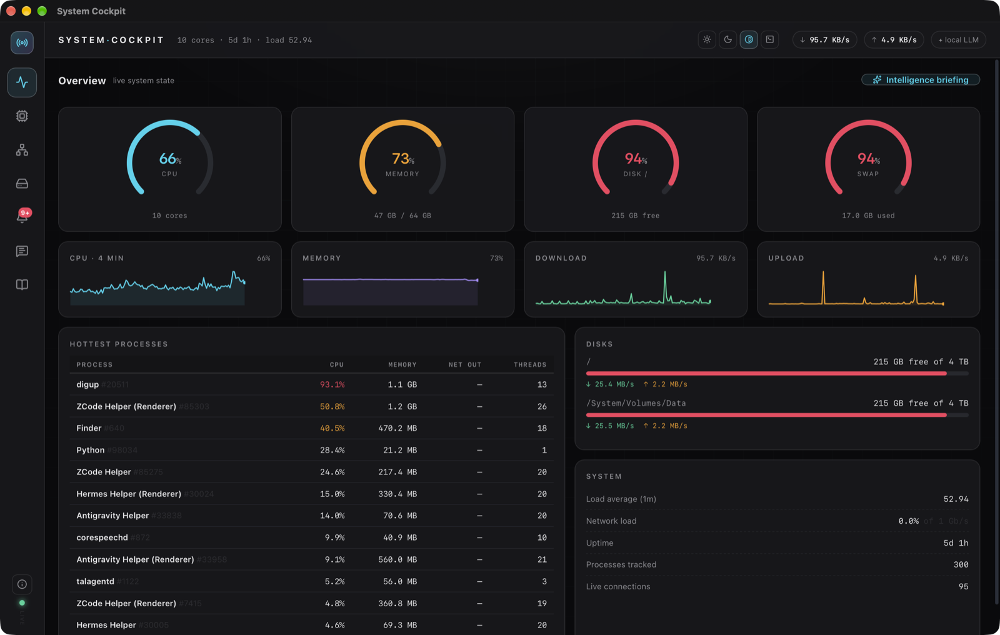
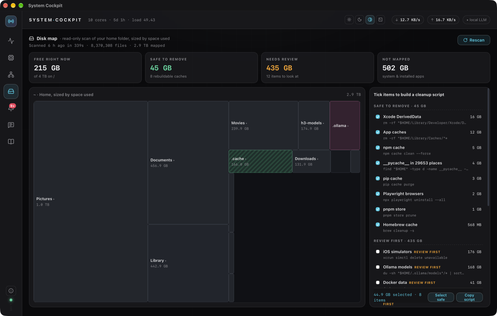
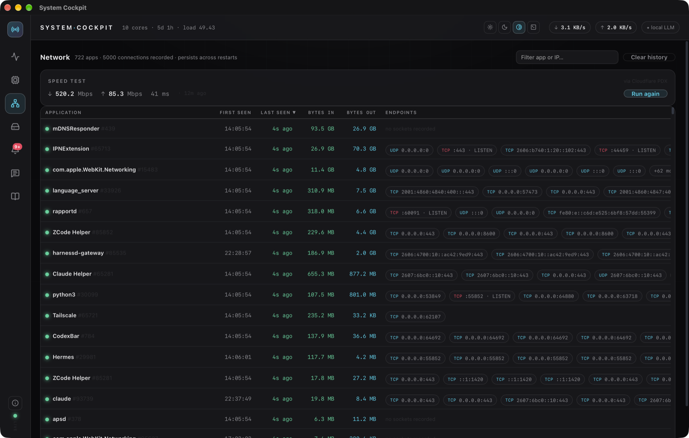
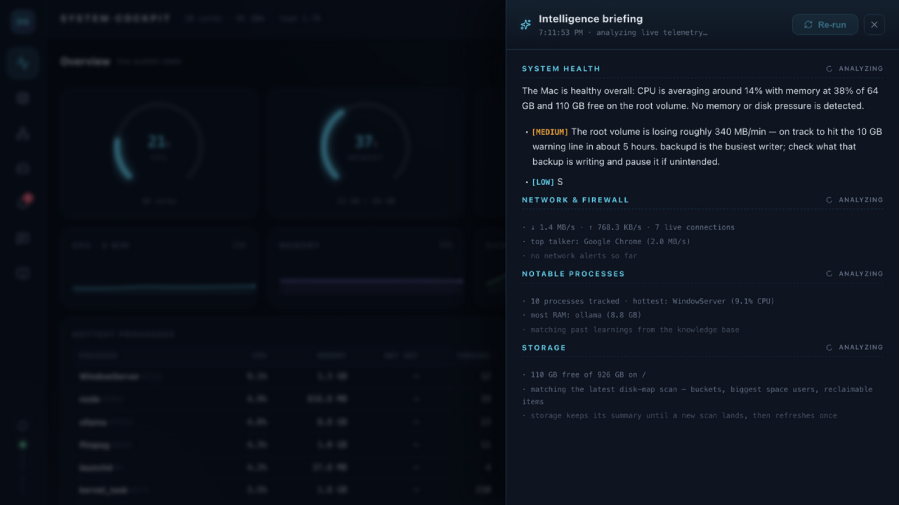
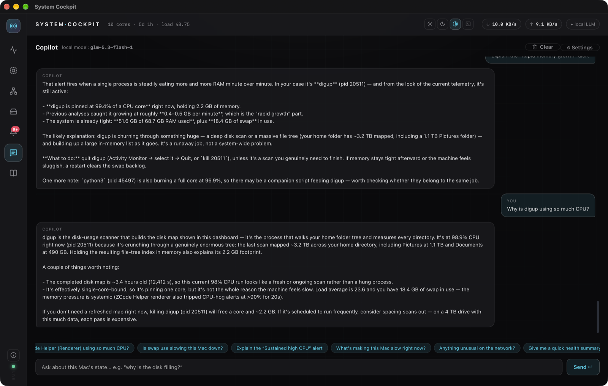
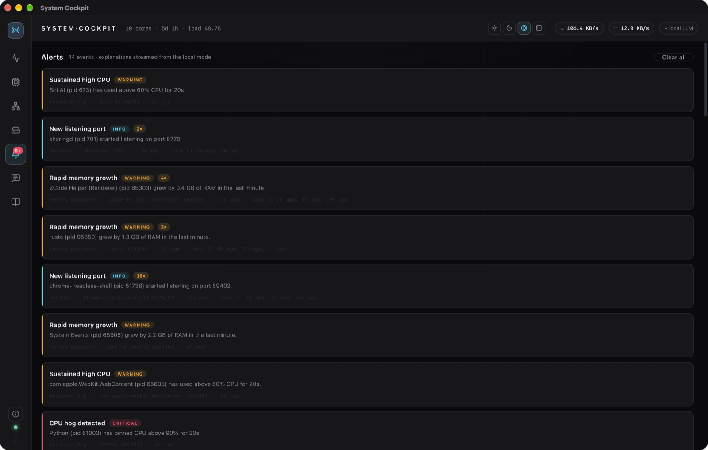

# System Cockpit

**A mission-control dashboard for your Mac.** Live gauges, a read-only disk map, a per-app network ledger, an AI intelligence briefing — in a 4.6 MB app that uses your Mac's own rendering engine and never phones home.

- **Download:** [Latest release](https://github.com/ThinkCode/system-cockpit/releases/latest) — `System_Cockpit_0.1.0_aarch64.dmg` (4.6 MB, Apple Silicon) or `System_Cockpit_0.1.0_x64.dmg` (Intel) · macOS 14+
- **Website:** https://thinkcode.github.io/system-cockpit/
- **Signed & notarized:** Developer ID, hardened runtime, notarized by Apple — no Gatekeeper warnings

---

## Why

Activity Monitor tells you *what* is happening. System Cockpit tells you *what it means*: which process is draining your disk and whether it's supposed to, which app is beaconing to 40 different IPs, whether that spike is a hung render loop or a backup doing its job — in plain language, next to the numbers.

It is built the way a native Mac app should be: Rust core, ~8 MB installed, no bundled Chromium (the UI renders in the WebKit already on your Mac), and a strict read-only stance — **it can look, it can't touch**.

## Features

### Live cockpit

CPU, memory, disk and swap gauges; 4-minute sparklines; hottest processes with per-process disk and network attribution; load average, uptime and socket counts — sampled twice a second by a Rust collector and streamed to the UI over IPC.

### Disk map — read-only by design

A treemap scan of your home folder sized by space used, with severity-tagged findings (what's big, what's stale, what's *weird*). The scan is strictly **read-only**: it never deletes anything. Cleanup happens only through a script the app writes out for you to inspect and run yourself — never auto-delete.

### Network ledger

Every app that has moved a packet, with bytes in/out, first/last seen and live socket endpoints. It persists across restarts, so "what talked to the network last Tuesday?" is one filter away. The table is virtualized — thousands of recorded apps cost nothing to scroll.

### Speed test — with honest failure modes

Real download/upload/ping against Cloudflare's edge, with live per-phase progress. If Cloudflare rate-limits the test, the app keeps your last known result on screen and arms a countdown from the server's `Retry-After` instead of showing a dead error.

### Intelligence briefing

A four-part briefing (system health, network & firewall, notable processes, storage) written by the LLM you point it at — the header chip shows exactly which model is live. It reads only the telemetry the app already has; severity-tagged findings link to the evidence.

### Copilot

Ask about your Mac in plain language: *"why is the disk filling up?"*, *"anything unusual on the network?"*, *"is swap use showing this Mac down?"* — answers stream from the same local model, grounded in live telemetry.

### Alerts & explanations

Threshold and pattern alerts (runaway CPU, disk-drain rates, memory growth, suspicious connection fan-out) with one-click plain-language explanations, all persisted locally.

## Privacy — the short version

- **Nothing phones home on its own.** No analytics, no crash reporter, no accounts, no update beacon. The only network touches are the speed test (runs only when *you* click) and the LLM endpoint *you* configure.
- **Everything is local, plain JSON** in `~/Library/Application Support/com.kiran.cockpit/` — network ledger, disk map, alerts, copilot history. Open it, back it up, delete it.
- **The disk scan is read-only.** It can look; it can't touch. Deletion only ever happens via a script you copy out and run yourself.
- **Full dependency credits** ship in-app and in [THIRD_PARTY_NOTICES.md](THIRD_PARTY_NOTICES.md).

## The numbers

| | |
|---|---|
| Download | **4.6 MB** (Apple Silicon) · **~5 MB** (Intel) — both notarized DMGs |
| Installed | **~8 MB** — one Rust binary, no bundled browser engine |
| App data | ~2 MB of plain JSON after a day of use |
| CPU | **~2%** with the window open (2 s telemetry loop); near-zero backgrounded |
| Memory | ~160 MB all-in at launch; renderer stays ~120 MB on the heaviest view |
| Talks to the network | Only when you click |

## Requirements

- Apple Silicon (M1 or later) or Intel (2018 or newer)
- macOS 14 (Sonoma) or newer
- For briefings & Copilot: any OpenAI-compatible endpoint — a local Ollama works great; the header chip shows the active model

## Install

1. Grab the DMG for your Mac from the [latest release](https://github.com/ThinkCode/system-cockpit/releases/latest): `System_Cockpit_0.1.0_aarch64.dmg` (Apple Silicon) or `System_Cockpit_0.1.0_x64.dmg` (Intel).
2. Open it, drag **System Cockpit** to Applications.
3. Launch. First run is verified by Gatekeeper against Apple's notarization service — no warnings, no right-click dance.

## FAQ

**Does it need an internet connection?**
No. Everything works offline except the speed test and briefings/Copilot (which need the LLM endpoint you configure).

**Where does my data live?**
`~/Library/Application Support/com.kiran.cockpit/` — plain JSON, inspectable, deletable.

**Can it delete files?**
No. The disk map is read-only by design. It can *write out a cleanup script* for you to review and run — that's the only path to deletion.

**What does the briefing send to the LLM?**
Only the telemetry snapshot the app already shows you (health metrics, process table, network summary, storage digest) — to the endpoint you configure. Nothing goes anywhere if you don't configure one.

**Intel Macs?**
Yes — a native Intel build ships alongside the Apple Silicon one (back to ~2018 Intel Macs on macOS 14+). Same features, same footprint discipline.

## Credits

Disk-map design borrows ideas from [ClearDisk](https://github.com/bysiber/cleardisk) (MIT). Built with [Tauri](https://tauri.app) — the full dependency list is in [THIRD_PARTY_NOTICES.md](THIRD_PARTY_NOTICES.md).
